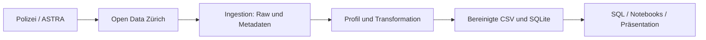

# Verkehrsunfälle in der Stadt Zürich

**Data Engineering · ZHAW HS26 · Projektarbeit Teil 1**

Ruben Souto, Issa Fawaz und Drin Muslija

Wir untersuchen **70’767 polizeilich registrierte Unfälle von 2011–2025**.
Eine Python-Pipeline verarbeitet die offenen Daten der Stadt Zürich. Der
aufbereitete Bestand wird in SQLite gespeichert und mit SQL/Pandas analysiert.

## Abgabe öffnen

| Unterlage | Inhalt |
|---|---|
| **[Präsentation als PDF](presentations/teil1_verkehrsunfaelle_zuerich.pdf)** | Projekt, Vorgehen und Ergebnisse auf 14 Haupt- und 4 Reservefolien |
| [Präsentation als PowerPoint](presentations/teil1_verkehrsunfaelle_zuerich.pptx) | Dieselben Folien als editierbare Datei mit Sprechernotizen |
| [01 · Datenprofil](notebooks/01_datenprofil.ipynb) | Prüfung der Rohdaten und Begründung der Aufbereitung |
| [02 · Analyse](notebooks/02_analyse.ipynb) | SQL-Abfragen, Diagramme, Hypothesentests und Antworten |
| [Datenbank](data/processed/accidents.sqlite) | Aufbereitete Unfälle für SQL-Abfragen; [Schema](src/de_projekt/schema.sql) |

Die Notebooks sind ausgeführt; ihre Ergebnisse lassen sich ohne Neulauf ansehen.
Dieses README dokumentiert Konzept, Entscheidungen und Ausführung.

## Aufbau

```text
README.md                Konzept, Entscheidungen und Ausführung
data/raw/                Unveränderte Quelldaten und Herkunftsmetadaten
data/processed/          Bereinigte Daten, SQLite und Ergebnisberichte
notebooks/               01 Datenprofil, 02 Analyse
presentations/           Präsentation als PPTX/PDF und Analyseabbildungen
src/de_projekt/          Python-Pipeline und SQL-Schema
tests/                   Automatisierte Prüfungen
```

`main` enthält den abgeschlossenen Projektstand. **`abgabe/teil1`** hält die
Teil-1-Abgabe fest. Der frühere Arbeitsbranch `feature/accident-data` bewahrt
auch interne Arbeitsunterlagen; diese sind kein Bestandteil der Abgabe.
Weitere Entwicklung erfolgt auf einem neuen Arbeitsbranch.

## Konzept und Forschungsfragen

Verkehrsunfälle verursachen Personen- und Sachschäden. Wir untersuchen zeitliche
Muster, Beteiligung und Schwere sowie Veränderungen über die Jahre. Der
Engineering-Beitrag besteht darin, die Quelle reproduzierbar zu beschaffen,
ihre Qualität zu beurteilen und sie für Analysen bereitzustellen.
**Eine Zeile entspricht einem Unfall**, nicht einer Person oder einer Fahrt.
Machine Learning gehört nicht zum Umfang von Teil 1.

| Forschungsfrage | Methode |
|---|---|
| **F1:** Wie unterscheiden sich registrierte Verkehrsunfälle nach Tageszeit und Wochentag? | Fallzahlen, relative Stundenverteilungen und H1 |
| **F2:** Besteht bei registrierten **Personenschadenunfällen** ein Zusammenhang zwischen Fussgänger-, Velo- bzw. Motorradbeteiligung und Unfallschwere? | Kreuztabellen, Schwereanteile und H2 |
| **F3:** Wie haben sich Anzahl und Zusammensetzung der registrierten Verkehrsunfälle über die Jahre verändert? | Jahreszahlen, Schwere- und Beteiligungsanteile; deskriptiv |

**H1:** Unter H0 ist die Stundenverteilung an Werktagen und Wochenenden gleich;
die Alternative erwartet unterschiedliche Verteilungen. Die Tabelle vergleicht
Montag–Freitag mit Samstag/Sonntag über 24 Stunden. Relative Anteile innerhalb
jeder Gruppe vermeiden einen blossen Vergleich von fünf mit zwei Tagen.
Feiertage werden nicht separat berücksichtigt.

**H2:** Unter H0 sind das jeweilige Beteiligungsmerkmal und die Unfallschwere
innerhalb der Personenschadenunfälle unabhängig; die Alternative erwartet einen
Zusammenhang. Je Merkmal wird beteiligt/nicht beteiligt mit den drei Schweregraden
leicht/schwer/tödlich verglichen. Ein Unfall zählt je Test einmal, kann aber
mehrere Beteiligungsmerkmale besitzen.

Wir verwenden Pearson-Chi-Quadrat ohne Kontinuitätskorrektur, α = 0,05. Die drei
H2-p-Werte werden gemeinsam nach Holm korrigiert; H1 ist eine separate Testfamilie.
Fallzahlen, erwartete Häufigkeiten und Cramérs V ergänzen die p-Werte. Alle
erwarteten Zellen liegen über 5; die implementierte Monte-Carlo-Alternative wurde
hier nicht benötigt. Die Unabhängigkeit der Beobachtungen bleibt eine
Modellannahme. Deskriptive Jahreskontrollen ersetzen keine adjustierte Analyse.

## Datengrundlage und Grenzen

Quelle: [Open Data Zürich – Verkehrsunfälle seit 2011](https://data.stadt-zuerich.ch/dataset/sid_dav_strassenverkehrsunfallorte).
Datenowner: Dienstabteilung Verkehr; Datenlieferant und Quellenangabe:
**Bundesamt für Strassen ASTRA**. Lizenz laut Katalog: Creative Commons Attribution.

Der Snapshot vom **13. Oktober 2026** enthält 36 Spalten und 70’767 eindeutige
Unfall-IDs. Er umfasst Zeitfelder, Unfallart, Schwere, Strassenart, Beteiligung
und LV95-Koordinaten. Ein exaktes Unfalldatum fehlt; Velobeteiligung umfasst auch
E-Bikes. Die Quelle wird jährlich aktualisiert. Abrufzeit, URLs, Grösse und
SHA-256 stehen in [source_metadata.json](data/raw/source_metadata.json), die
Definitionen in [catalog_metadata.json](data/raw/catalog_metadata.json).

- **Erfassungswechsel:** Seit Juli 2015 werden auch polizeilich registrierte
  Bagatellunfälle als Sachschäden gemeldet. Gesamtzahlen über diesen Bruch sind
  eingeschränkt vergleichbar.
- **Beteiligungsdefinition:** Der Katalog bezieht Beteiligungsmerkmale auf
  Personenschäden. Im Snapshot gibt es positive Sachschadenangaben: Fussgänger
  169, Velo 1’612, Motorrad 1’777. Die Ursache ist ungeklärt. Wir erhalten die
  Werte und beschränken F2/H2 vorsichtig auf Personenschadenunfälle.
- **Aussagegrenzen:** Nicht registrierte Unfälle fehlen. Ohne Verkehrsleistung
  lassen sich keine Risiken pro Fahrt oder Kilometer berechnen. Wetter,
  Infrastruktur und Exposition sind nicht kontrolliert; Zusammenhänge beweisen
  keine Ursache. Die Schwere gehört zum Unfall und identifiziert keine verletzte Person.

## Data-Engineering-Lebenszyklus



| Phase | Umsetzung |
|---|---|
| Generation | Polizeiliche Erfassung und Meldung im ASTRA-System ausserhalb des Projekts |
| Ingestion | CSV und Metadaten beziehen; unveränderter Snapshot mit Struktur- und Prüfsummenprüfung |
| Storage | Raw erhalten; aufbereiteten Bestand als CSV und SQLite speichern |
| Transformation | Datenprofil, explizite Typen, Spaltenauswahl, drei Features und Qualitätsbericht |
| Serving | Lesende SQL-/Notebook-Analyse und Präsentation; eigener Dienst bleibt ausserhalb von Teil 1 |

**Unterströmungen:** Sicherheit durch öffentliche Daten ohne Zugangsdaten im
Repository; Governance durch Quelle, Lizenz und Metadaten; DataOps durch Tests,
Qualitätsberichte und Fehlerabbruch; Orchestrierung durch `pipeline.py`;
Software Engineering durch getrennte Module und Git-Versionierung.
Storage begleitet mehrere Phasen. Die jährlich publizierte Quelle passt zur
lokalen Batch-Verarbeitung. Bei wesentlich grösseren Daten wäre chunkweise
Verarbeitung, bei zentralem Mehrnutzerbedarf eine Serverdatenbank zu evaluieren.
Eine solche Lastskalierung wurde nicht implementiert oder getestet.

## Speicherung und Transformation

| Option | Beurteilung |
|---|---|
| CSV | Einfaches Original-/Austauschformat; keine Datenbank-Constraints |
| **SQLite – gewählt** | SQL, Primärschlüssel, CHECK-Regeln und Transaktionen in einer portablen Datei; passend für lokale Leseanalysen |
| PostgreSQL | Zentraler Mehrnutzerbetrieb und viele parallele Schreibzugriffe; zusätzlicher Serverbetrieb aktuell nicht erforderlich |

Feste Spalten, eine eindeutige Unfall-ID und SQL-Aggregationen eignen sich für
relationale Speicherung. Eine Unfalltabelle genügt; `pipeline_metadata` hält
zusätzlich Herkunft und Versionen fest. Jede Person nutzt eine lokale Kopie.

Das Datenprofil zeigt keine leeren Felder, geprüften NA-Marker, Rand-Leerzeichen
oder Duplikate. Zeitfelder sind gültig; alle 180 Jahr-Monat-Kombinationen sind
vertreten. Das beweist keine vollständige Erfassung aller Tage. 803 Unfälle
besitzen mehrere Beteiligungsmerkmale. Eine numerische Koordinatenprüfung ist
keine Stadtgrenzenprüfung.

Die Transformation wählt **19 Originalfelder und ergänzt 3 Features**:

| Feature | Regel und Verwendung |
|---|---|
| `is_weekend` | Samstag/Sonntag = 1; Gruppierung für F1/H1 |
| `time_period` | Vier Sechs-Stunden-Blöcke; ergänzende Gruppierung, H1 nutzt die Originalstunde |
| `vulnerable_road_user` | Fussgänger ODER Velo; ergänzendes Merkmal, kein eigener H2-Test |

Keine Zeile wird gelöscht und kein Wert imputiert. Alle Originalspalten bleiben
im Raw erhalten. Typen sind explizit: Textcodes behalten führende Nullen;
0 bedeutet nein, ein fehlender Wert unbekannt. Ungültige Werte oder doppelte IDs
führen zum Abbruch. Regeln und Prüfsummen stehen im
[Qualitätsbericht](data/processed/quality_report.json).

`storage.py` baut eine neue Datenbank temporär und transaktional auf, vergleicht
die Werte mit der CSV und prüft die Integrität. Erst danach ersetzt sie die alte
Datei. Neuläufe hängen keine Zeilen an. CSV und Qualitätsbericht werden einzeln
atomar geschrieben; ein unpassendes Paar wird über die Prüfsumme erkannt.

## Ergebnisse

| Frage | Befund | Einordnung |
|---|---|---|
| F1 | Spitzenstunde werktags 17 Uhr, am Wochenende 14 Uhr. Nachtanteil 3,71 % gegenüber 14,63 %. χ²(23) = 3’877,06; p < 0,001; V = 0,234 | Anteile innerhalb jeder Gruppe; kein Risiko pro Fahrt |
| F2 | Alle drei Vergleiche nach Holm signifikant. V: Fussgänger 0,104, Velo 0,054, Motorrad 0,036. Schwer/tödlich mit Fussgängerbeteiligung 23,42 %, ohne 15,02 % | 18’164 Personenschadenunfälle; kleine Assoziationen, keine Kausalaussage |
| F3 | 2016–2025: Gesamtzahl 5’556 → 4’714, Personenschäden 1’262 → 1’310. Veloanteil an Personenschadenunfällen 26,12 % (2011) → 40,38 % (2025) | Keine stetige Zunahme; Erfassungswechsel 2015 beachten |

Kleinste erwartete Zellen: H1 114,61; H2 mindestens 15,59. Der H1-p-Wert
unterläuft numerisch auf 0 und wird als p < 0,001 berichtet. Ein kleiner p-Wert
allein belegt keine praktische Relevanz. Jahreskontrollen zeigen den höheren
Nachtanteil am Wochenende in 15/15 Jahren. Höhere schwere/tödliche Anteile mit
Beteiligung zeigen sich für Fussgänger in 15/15, Velo in 11/15 und Motorrad in
13/15 Jahren. Dies sind keine adjustierten Tests. Rechenwege und Tabellen:
[Analyse-Notebook](notebooks/02_analyse.ipynb).

## Ausführung

Voraussetzung: Python ≥ 3.11 und SQLite ≥ 3.37 für `STRICT`-Tabellen.
Geprüft: **Windows, Python 3.14.3, SQLite 3.50.4**. Python bringt SQLite mit.
`requirements-lock.txt` hält die geprüften Paketversionen dieser Umgebung fest;
andere Betriebssystem-/Python-Kombinationen wurden nicht gesondert geprüft.

Im Hauptverzeichnis mit PowerShell:

```powershell
python -m venv .venv
.\.venv\Scripts\python.exe -m pip install -r requirements-lock.txt
.\.venv\Scripts\python.exe -m pip install --no-deps -e .

# Vorhandenen Snapshot offline verarbeiten: Transformation → SQLite.
.\.venv\Scripts\python.exe -m de_projekt.pipeline

# Profil und Analyse ausführen.
.\.venv\Scripts\python.exe -m jupyter nbconvert --to notebook --execute --inplace notebooks/01_datenprofil.ipynb
.\.venv\Scripts\python.exe -m jupyter nbconvert --to notebook --execute --inplace notebooks/02_analyse.ipynb

# Implementierung prüfen.
.\.venv\Scripts\python.exe -m pytest -q
.\.venv\Scripts\python.exe -m ruff check .
```

Bei einer neuen Quelle kommt das Profil fachlich vor dem Ableiten neuer Regeln.
Der dokumentierte Ablauf nutzt die bereits festgelegten Regeln. Ein neuer
Download erfolgt nur mit `python -m de_projekt.ingestion --refresh` und wird
separat abgelegt. Die Pipeline unterstützt `--raw-dir` und `--output-dir`;
die Notebooks verwenden die Standardpfade aus `config.py`.

## Datenbank und Prüfstand

Zum Öffnen genügt `data/processed/accidents.sqlite`; Zugangsdaten sind nicht nötig.
Die Reproduktion benötigt zusätzlich Code, Raw und Metadaten. Beispiel:

```sql
SELECT AccidentYear, COUNT(*) AS anzahl
FROM accidents
GROUP BY AccidentYear
ORDER BY AccidentYear;
```

`accidents` enthält 70’767 Zeilen und 22 Spalten. `AccidentUID` ist der
Primärschlüssel; `STRICT` und `CHECK` sichern Typen, Wertebereiche und Features.
Die Analyse öffnet SQLite nur lesend und prüft Herkunft und Integrität.

**Prüfung am 26. Oktober 2026:** 43 Tests bestanden, Ruff erfolgreich, Pipeline
und beide Notebooks im isolierten Neulauf geprüft. Fachliche Ergebnisse und
bereinigte CSV wurden reproduziert. Präsentation mit PowerPoint geöffnet, als
PDF exportiert und auf Darstellungsfehler geprüft. Erstellzeitpunkte können sich
bei Neuläufen ändern; der Raw-Snapshot bleibt erhalten.

## Quellen und Hilfsmittel

- [Open Data Zürich / Bundesamt für Strassen ASTRA](https://data.stadt-zuerich.ch/dataset/sid_dav_strassenverkehrsunfallorte)
- [SQLite: Appropriate Uses](https://www.sqlite.org/whentouse.html)
- [SciPy: chi2_contingency](https://docs.scipy.org/doc/scipy/reference/generated/scipy.stats.chi2_contingency.html)
- Holm (1979), *A Simple Sequentially Rejective Multiple Test Procedure*,
  Scandinavian Journal of Statistics 6(2), 65–70.
- OpenAI Codex / ChatGPT unterstützte Code, Dokumentation, Prüfung und Folien.
  Die fachliche Verantwortung liegt beim Team; ergänzende Kursvorgaben zu
  Hilfsmittelerklärungen gelten zusätzlich.
