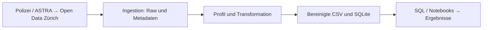

# Verkehrsunfälle in der Stadt Zürich

Projektarbeit Teil 1 · Data Engineering, ZHAW HS26
Ruben Souto, Issa Fawaz und Drin Muslija

Wir untersuchen, wann registrierte Verkehrsunfälle in Zürich auftreten, wie
Beteiligung und Unfallschwere zusammenhängen und wie sich der Bestand über die
Jahre verändert. Dafür verarbeiten wir **70’767 Unfälle von 2011–2025** aus dem
Open-Data-Katalog der Stadt Zürich. Teil 1 umfasst Datenbeschaffung, erste
Qualitätsprüfung und Aufbereitung, SQLite-Speicherung sowie erste Analysen.

## Unterlagen und Projektstruktur

- **[Präsentation](presentations/teil1_verkehrsunfaelle_zuerich.pptx):**
  15 Hauptfolien für drei Personen mit je fünf Minuten; vier Reservefolien.
- **[Datenprofil](notebooks/01_datenprofil.ipynb):** ausgeführte Prüfung der Rohdaten.
- **[Analyse](notebooks/02_analyse.ipynb):** SQL-Abfragen, Diagramme, Hypothesentests
  und Antworten auf die Forschungsfragen; ebenfalls ausgeführt.
- **[SQLite-Datenbank](data/processed/accidents.sqlite)** und
  **[SQL-Schema](src/de_projekt/schema.sql)**.

| Verzeichnis | Inhalt |
|---|---|
| `data/raw/` | Original-CSV, Katalogbeschreibung und Herkunftsmetadaten |
| `data/processed/` | Bereinigte CSV, SQLite, Qualitätsbericht und Analyseergebnisse |
| `src/de_projekt/` | Ingestion, Transformation, Storage, Pipeline, Statistik und optionaler Benchmark |
| `notebooks/` | Datenprofil und Analyse mit gespeicherten Ausgaben |
| `presentations/` | Editierbare Präsentation und aus dem Analyse-Notebook erzeugte Abbildungen |
| `tests/` | Automatisierte Prüfungen der Verarbeitung und Statistik |

## Fragestellungen und Methoden

Eine Zeile entspricht einem **Unfall**, nicht einer Person oder einer Fahrt.
Die Ergebnisse beschreiben den registrierten Bestand. Sie können weitere
Untersuchungen zur Verkehrssicherheit begründen, erlauben aber keine Aussage
zum individuellen Risiko einer Verkehrsart.

| Forschungsfrage | Auswertung |
|---|---|
| **F1:** Wie unterscheiden sich registrierte Unfälle nach Tageszeit und Wochentag? | Stunden- und Wochentagsverteilungen; H1 |
| **F2:** Hängt bei **Personenschadenunfällen** die Beteiligung von Fussgängern, Velos bzw. Motorrädern mit der Unfallschwere zusammen? | Drei Beteiligungsvergleiche und Schwereanteile; H2 |
| **F3:** Wie haben sich Anzahl und Zusammensetzung der Unfälle über die Jahre verändert? | Deskriptive Jahresreihen sowie Schwere- und Beteiligungsanteile |

**H1:** Unter H0 ist die Stundenverteilung an Werktagen und Wochenenden gleich;
die Alternative lautet, dass sie sich unterscheidet. Die Tabelle vergleicht
Montag–Freitag und Samstag/Sonntag über 24 Stunden. Für die Darstellung werden
Anteile innerhalb jeder Gruppe verwendet. Feiertage werden nicht separat erfasst.

**H2:** Unter H0 sind das jeweilige Beteiligungsmerkmal und die Unfallschwere
unabhängig; die Alternative erwartet einen Zusammenhang. Je Merkmal wird
beteiligt/nicht beteiligt mit leicht/schwer/tödlich verglichen. Ein Unfall kann
mehrere Beteiligungsmerkmale besitzen, zählt aber innerhalb jedes Tests einmal.

Wir verwenden den Pearson-Chi-Quadrat-Test ohne Kontinuitätskorrektur bei
α = 0,05. Die drei H2-p-Werte werden gemeinsam nach Holm korrigiert; H1 ist
eine separate Testfamilie. Fallzahlen, erwartete Häufigkeiten und Cramérs V
ergänzen die p-Werte. Alle erwarteten Zellen liegen im aktuellen Bestand über 5;
die implementierte Monte-Carlo-Alternative wurde deshalb nicht benötigt.
Zeitliche Unabhängigkeit bleibt eine Modellannahme. Jahreskontrollen sind
deskriptiv und keine um weitere Einflussgrössen bereinigten Tests.

## Datenquelle und Aussagegrenzen

Quelle: [Open Data Zürich – Verkehrsunfälle seit 2011](https://data.stadt-zuerich.ch/dataset/sid_dav_strassenverkehrsunfallorte).
Datenowner: Dienstabteilung Verkehr; Datenlieferant und Quellenangabe:
**Bundesamt für Strassen ASTRA**. Lizenz laut gespeichertem Katalog:
Creative Commons Attribution.

Unser Snapshot wurde am **13. Oktober 2026** bezogen: 70’767 eindeutige Unfall-IDs,
36 Spalten. Enthalten sind Jahr, Monat, Wochentag, Stunde, Unfallart, Schwere,
Strassenart, Beteiligungsmerkmale und LV95-Koordinaten. Ein exaktes Datum fehlt.
Velobeteiligung umfasst laut Katalog auch E-Bikes. Die Quelle wird jährlich
aktualisiert. URLs, Abrufzeit und SHA-256-Prüfsumme stehen in
[source_metadata.json](data/raw/source_metadata.json); die Katalogbeschreibung
liegt in [catalog_metadata.json](data/raw/catalog_metadata.json).

- **Erfassungswechsel:** Seit Juli 2015 werden auch polizeilich registrierte
  Bagatellunfälle als Sachschäden gemeldet. Gesamtzahlen vor und nach diesem
  Zeitpunkt sind eingeschränkt vergleichbar.
- **Beteiligungsdefinition:** Der Katalog bezieht die Beteiligungsmerkmale auf
  Personenschäden. Der Snapshot enthält auch positive Sachschadenangaben:
  Fussgänger 169, Velo 1’612, Motorrad 1’777. Die Ursache ist ungeklärt. Wir
  erhalten die Werte und begrenzen F2/H2 auf Personenschadenunfälle.
- **Grenzen:** Nicht registrierte Unfälle fehlen. Ohne Verkehrsleistung gibt
  es kein Risiko pro Fahrt oder Kilometer. Wetter und Infrastruktur sind nicht
  kontrolliert; Zusammenhänge belegen keine Ursache. Der Schweregrad gehört zum
  gesamten Unfall und identifiziert nicht die verletzte Person.

## Data-Engineering-Lebenszyklus



| Phase | Umsetzung und Begründung |
|---|---|
| Generation | Polizeiliche Erfassung und Meldung im ASTRA-System; ausserhalb unseres Projekts |
| Ingestion | CSV und Katalogmetadaten beziehen; Struktur, Pflichtfelder, Grösse und Prüfsumme prüfen |
| Storage | Unveränderte Rohdaten erhalten; aufbereiteten Bestand als CSV und SQLite speichern |
| Transformation | Datenprofil, Typisierung, Spaltenauswahl, drei Features und Qualitätsbericht |
| Serving | Für Teil 1 lesende SQL-/Notebook-Analyse und Präsentation; die weiterführende Serving-Lösung folgt in Teil 2 |

Die jährlich veröffentlichte Quelle passt zu einer lokalen Batch-Verarbeitung.
`pipeline.py` übergibt die Pfade zwischen den Verarbeitungsschritten und stoppt
bei Fehlern. Storage begleitet mehrere Phasen, bereits ab dem Raw-Snapshot.

**Unterströmungen:** Öffentliche Daten und keine Zugangsdaten im Repository
vereinfachen die Sicherheit. Quelle, Lizenz und Metadaten sichern die Herkunft.
Tests, Qualitätsberichte und Fehlerabbrüche unterstützen DataOps. Getrennte
Module und Git-Versionierung unterstützen Software Engineering; `pipeline.py`
übernimmt die Orchestrierung. Zusätzliche Quellen, zentrale Nutzung oder grössere
Datenmengen würden eine erneute Architekturentscheidung erfordern.

## Speicherwahl und erste Aufbereitung

| Option | Entscheidung |
|---|---|
| CSV | Originalformat und bereinigter Export; einfach austauschbar, aber ohne Datenbank-Constraints |
| **SQLite** | Gewählt für lokale SQL-Analysen: Primärschlüssel, CHECK-Regeln und Transaktionen ohne Datenbankserver |
| PostgreSQL | Alternative für zentralen Mehrnutzerbetrieb mit vielen Schreibzugriffen; aktuell kein entsprechender Bedarf |

Die festen Attribute und die eindeutige Unfall-ID passen zur relationalen
Speicherung. Eine Unfalltabelle genügt für diese Fragen. `pipeline_metadata`
speichert Herkunft, Prüfsummen und Versionen. Jede Person verwendet eine lokale
Kopie. Die Datei ist keine gleichzeitig über ein Netzlaufwerk bearbeitete Datenbank.

Das Datenprofil zeigt keine leeren Felder, geprüften NA-Marker, Rand-Leerzeichen
oder Duplikate. Die Zeitwerte sind gültig und alle 180 Jahr-Monat-Kombinationen
vertreten; dies beweist keine vollständige Erfassung aller Tage. 803 Unfälle
haben mehrere Beteiligungsmerkmale. Koordinaten werden numerisch geprüft,
aber nicht mit einer Stadtgrenze abgeglichen.

Die Transformation übernimmt **19 Originalfelder und ergänzt 3 Features**.
Keine Zeile wird gelöscht und kein Wert imputiert. Alle Originalspalten bleiben
im Raw erhalten. Textcodes behalten führende Nullen; Beteiligung wird als 0/1
gespeichert. Fehlende Werte bleiben unbekannt, ungültige Werte führen zum Abbruch.

| Feature | Regel und Verwendung |
|---|---|
| `is_weekend` | Samstag/Sonntag = 1; Gruppierung für H1 |
| `time_period` | Vier Sechs-Stunden-Blöcke; ergänzende Gruppierung, H1 verwendet die genaue Stunde |
| `vulnerable_road_user` | Projektbezogene Zusammenfassung Fussgänger ODER Velo; kein eigener H2-Test |

Regeln und Änderungen stehen im [Qualitätsbericht](data/processed/quality_report.json).
`storage.py` prüft CSV und Bericht, baut die neue Datenbank temporär und
transaktional auf und vergleicht alle Werte mit der CSV. Erst nach der
Integritätsprüfung ersetzt sie die alte Datei. Neuläufe hängen keine Unfälle an.
CSV und Bericht werden einzeln atomar geschrieben; die Prüfsumme erkennt ein
unpassendes Dateipaar.

## Erste Ergebnisse

| Frage | Befund | Einordnung |
|---|---|---|
| F1 | Spitzenstunde werktags 17 Uhr, am Wochenende 14 Uhr. Nachtanteil 3,71 % gegenüber 14,63 %. χ²(23) = 3’877,06; p < 0,001; V = 0,234 | Stundenanteile innerhalb jeder Gruppe, keine Risiken pro Fahrt |
| F2 | Alle drei Tests nach Holm signifikant. V: Fussgänger 0,104, Velo 0,054, Motorrad 0,036. Schwer/tödlich mit Fussgängerbeteiligung 23,42 %, ohne 15,02 % | 18’164 Personenschadenunfälle; kleine Assoziationen, keine Kausalaussage |
| F3 | 2016–2025: Gesamtzahl 5’556 → 4’714, Personenschäden 1’262 → 1’310. Veloanteil an Personenschadenunfällen 26,12 % (2011) → 40,38 % (2025) | Keine stetige Zunahme; Erfassungswechsel 2015 beachten |

Die kleinste erwartete Zelle beträgt bei H1 114,61 und bei H2 mindestens 15,59.
Der H1-p-Wert unterläuft numerisch auf 0; wir berichten p < 0,001. Ein kleiner
p-Wert allein zeigt keine praktische Relevanz. Deskriptiv ist der Nachtanteil
am Wochenende in 15/15 Jahren höher. Höhere schwere/tödliche Anteile mit
Beteiligung zeigen sich für Fussgänger in 15/15, Velo in 11/15 und Motorrad in
13/15 Jahren. Tabellen, Rechenwege und Grenzen stehen im
[Analyse-Notebook](notebooks/02_analyse.ipynb) und in
[analysis_summary.json](data/processed/analysis_summary.json).

### Ergänzender Mengentest

`benchmark.py` vervielfacht den Snapshot mit neuen IDs und misst die Verarbeitung
in getrennten Prozessen. Dies sind synthetische Testdaten, keine neuen Unfallbeobachtungen.
Die gespeicherte [Messreihe](data/processed/scaling_benchmark.csv) stammt von
macOS/arm64 mit Python 3.14.7:

| Faktor | Zeilen | Verarbeitung inkl. SQL | Spitzenspeicher des Prozesses |
|---|---:|---:|---:|
| 1× | 70’767 | 5,162 s | 304 MiB |
| 2× | 141’534 | 9,558 s | 440 MiB |
| 5× | 353’835 | 27,053 s | 966 MiB |
| 10× | 707’670 | 56,211 s | 1’835 MiB |

Je Faktor liegt ein Messwert vor. Bei 10× Daten wurden rund 11× Laufzeit und
6× Spitzenspeicher gegenüber 1× gemessen. Daraus folgt keine belastbare
Kapazitätsprognose für 8 GB RAM, andere Rechner oder zukünftige Daten. Die Zeiten
enthalten weder die Vorbereitung der Testdaten noch den Python-Start; der
Spitzenspeicher umfasst Imports und Verarbeitung. Der Benchmark wurde auf
Windows nicht neu gemessen. Seine Speichermessung unterstützt nur macOS/Linux;
die eigentliche Pipeline und die Tests sind davon unabhängig.

## Reproduktion

Benötigt werden Python ≥ 3.11 und SQLite ≥ 3.37 (`STRICT`-Tabellen). Python
bringt SQLite mit. Die Abschlussprüfung erfolgte unter **Windows, Python 3.14.3,
SQLite 3.50.4**. Das Lockfile beschreibt diese Windows-Referenzumgebung.
Die gespeicherten Benchmarkwerte belegen keine Prüfung des Lockfiles auf macOS.

Unter Windows im Projektordner, mit einer funktionsfähigen Python-Installation:

```powershell
python -m venv .venv
.\.venv\Scripts\python.exe -m pip install -r requirements-lock.txt
.\.venv\Scripts\python.exe -m pip install --no-deps -e .

.\.venv\Scripts\python.exe -m de_projekt.pipeline
.\.venv\Scripts\python.exe -m jupyter nbconvert --to notebook --execute --inplace notebooks/01_datenprofil.ipynb
.\.venv\Scripts\python.exe -m jupyter nbconvert --to notebook --execute --inplace notebooks/02_analyse.ipynb
.\.venv\Scripts\python.exe -m pytest -q
.\.venv\Scripts\python.exe -m ruff check .
```

Auf anderen Systemen die Anforderungen aus `pyproject.toml` installieren:
`python -m pip install -e ".[dev]"` in einer eigenen virtuellen Umgebung;
die Paketauflösung dort gesondert prüfen. Der optionale Mengentest läuft unter
macOS/Linux mit `python -m de_projekt.benchmark`. Er überschreibt standardmässig
die Mess-CSV; für einen Vergleich einen anderen Pfad mit `--output` wählen.

Der Standardlauf arbeitet offline mit dem vorhandenen Snapshot. Bei einer neuen
Quelle muss zunächst das Datenprofil geprüft werden, bevor neue Regeln festgelegt
werden. `ingestion --refresh` bezieht einen separaten Snapshot. Die Pipeline
unterstützt `--raw-dir` und `--output-dir`; die Notebooks verwenden die Standardpfade
aus `config.py`. Neuläufe ändern Erstellzeitpunkte, nicht den Raw-Snapshot.

**Prüfstand 27. Oktober 2026:** 45 Tests bestanden, Ruff erfolgreich; Snapshot
und SQLite-Integrität geprüft. Die statistischen Ergebnisse wurden unabhängig
nachgerechnet. Ein isolierter Pipeline-/Notebook-Lauf reproduzierte die fachlichen
Ergebnisse und die bereinigte CSV, ohne die gespeicherten Abgabedaten zu überschreiben.

## Grenzen von Teil 1 und Ausblick

Für Teil 2 folgen die abschliessende Analyse und Transformation, die
Finalisierung des Lebenszyklus und eine weiterführende Serving-Lösung. Deren
konkrete Form ist noch festzulegen. Die jetzigen SQL-/Notebook-Auswertungen
ersetzen diese spätere Umsetzung nicht.

## Quellen und Hilfsmittel

- [Open Data Zürich / Bundesamt für Strassen ASTRA](https://data.stadt-zuerich.ch/dataset/sid_dav_strassenverkehrsunfallorte)
- [SQLite: Appropriate Uses](https://www.sqlite.org/whentouse.html)
- [SciPy: chi2_contingency](https://docs.scipy.org/doc/scipy/reference/generated/scipy.stats.chi2_contingency.html)
- Holm (1979), *A Simple Sequentially Rejective Multiple Test Procedure*,
  Scandinavian Journal of Statistics 6(2), 65–70.
- OpenAI Codex / ChatGPT und Anthropic Claude Code unterstützten Code,
  Dokumentation, Prüfung und Folien. Die fachliche Verantwortung liegt beim Team;
  ergänzende Kursvorgaben zu Hilfsmittelerklärungen gelten zusätzlich.
