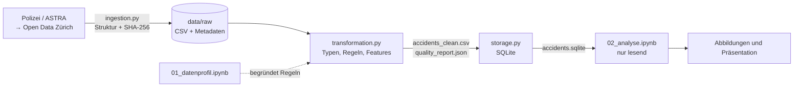

# Verkehrsunfälle in der Stadt Zürich

**Data Engineering · ZHAW HS26 · Projektarbeit Teil 1**

Ruben Souto, Issa Fawaz und Drin Muslija

Wir untersuchen **70’767 polizeilich registrierte Unfälle von 2011–2025**.
Eine Python-Pipeline bezieht die offenen Daten der Stadt Zürich, prüft und
bereinigt sie, speichert sie in SQLite und wertet sie mit SQL/Pandas aus.

## Schnelleinstieg

| Unterlage | Inhalt |
|---|---|
| **[Präsentation (PDF)](presentations/teil1_verkehrsunfaelle_zuerich.pdf)** | Projekt, Vorgehen und Ergebnisse; 14 Haupt- und 4 Reservefolien (A–D) |
| [Präsentation (PowerPoint)](presentations/teil1_verkehrsunfaelle_zuerich.pptx) | Dieselben Folien mit Sprechernotizen |
| [01 · Datenprofil](notebooks/01_datenprofil.ipynb) | Prüfung der Rohdaten; begründet die Bereinigungsregeln |
| [02 · Analyse](notebooks/02_analyse.ipynb) | SQL-Abfragen, Diagramme, Hypothesentests und Antworten |
| [Datenbank](data/processed/accidents.sqlite) | Aufbereitete Unfälle, direkt mit SQL abfragbar |

Die Notebooks sind bereits ausgeführt und ohne Neulauf lesbar. Alle Daten liegen
vollständig im Repository (Raw-CSV 37 MB, unter der GitHub-Grenze von 100 MB);
ein externer Datenlink ist nicht nötig.

**Branches:** `abgabe/teil1` hält die Teil-1-Abgabe unverändert fest; `main`
enthält den abgeschlossenen Projektstand. Der frühere Arbeitsbranch
`feature/accident-data` enthält interne Arbeitsunterlagen und gehört nicht zur Abgabe.

## Wegweiser zum Bewertungsraster

| Bewertungsbereich | Beschreibung im README | Umsetzung | Folien |
|---|---|---|---|
| Konzeptionalisierung | [Konzept](#konzept-und-forschungsfragen), [Daten und Grenzen](#datengrundlage-und-grenzen) | [02 · Analyse](notebooks/02_analyse.ipynb) | 2–3 |
| Entwurf des DE-Lebenszyklus | [Lebenszyklus](#data-engineering-lebenszyklus) | [pipeline.py](src/de_projekt/pipeline.py), [config.py](src/de_projekt/config.py) | 4, C |
| Ingestion | [Ingestion](#ingestion) | [ingestion.py](src/de_projekt/ingestion.py), [Tests](tests/test_ingestion.py) | 5 |
| Storage | [Storage](#storage) | [storage.py](src/de_projekt/storage.py), [schema.sql](src/de_projekt/schema.sql), [Tests](tests/test_storage.py) | 6, A |
| Transformation Teil 1 | [Transformation](#transformation), [Ergebnisse](#ergebnisse) | [01 · Datenprofil](notebooks/01_datenprofil.ipynb), [transformation.py](src/de_projekt/transformation.py), [Tests](tests/test_transformation.py) | 7–13, B |
| Skalierbarkeit (alle Bereiche) | [Skalierbarkeit](#skalierbarkeit-gemessen) | [benchmark.py](src/de_projekt/benchmark.py), [Messwerte](data/processed/scaling_benchmark.csv) | – |

## Konzept und Forschungsfragen

Verkehrsunfälle verursachen Personen- und Sachschäden. Wir untersuchen, **wann**
Unfälle auftreten, **wer** beteiligt ist und wie schwer sie sind, und **wie** sich
das über die Jahre verändert. Der Data-Engineering-Beitrag: die Quelle
reproduzierbar beschaffen, ihre Qualität prüfen und sie geprüft für Analysen
bereitstellen. **Eine Zeile entspricht einem Unfall**, nicht einer Person oder Fahrt.

**Nutzen:** Verkehrsplanung und Polizei erfahren, zu welchen Zeiten Unfälle
gehäuft auftreten (Kontrollen, Signalisation) und welche Beteiligten schwerere
Folgen erleben (Schutz von Fussgängern und Velofahrenden). Öffentlichkeit und
Medien erhalten dieselben Zahlen mit offengelegten Grenzen.

**Abgrenzung:** Im Umfang sind Bezug, Prüfung, Aufbereitung, Speicherung und
eine erste statistische Auswertung. Nicht im Umfang sind Echtzeitdaten,
Verkehrsmengen, Wetter, Strassennetz und Machine Learning.

| Forschungsfrage | Hypothese (H0 / Alternative) |
|---|---|
| **F1:** Wie unterscheiden sich registrierte Unfälle nach Tageszeit und Wochentag? | **H1:** Die Stundenverteilung (24 Stunden) ist an Werktagen und am Wochenende gleich / unterschiedlich. Verglichen werden Anteile innerhalb jeder Gruppe, damit nicht fünf mit zwei Tagen verglichen werden. Feiertage sind nicht separat berücksichtigt. |
| **F2:** Hängt bei **Personenschadenunfällen** die Beteiligung von Fussgängern, Velos bzw. Motorrädern mit der Unfallschwere zusammen? | **H2:** Beteiligung (ja/nein) und Schwere (leicht/schwer/tödlich) sind unabhängig / hängen zusammen. Ein Test je Merkmal; ein Unfall kann mehrere Merkmale besitzen. |
| **F3:** Wie haben sich Anzahl und Zusammensetzung der Unfälle über die Jahre verändert? | Kein Test; deskriptive Jahreszahlen, Schwere- und Beteiligungsanteile |

## Datengrundlage und Grenzen

Quelle: [Open Data Zürich – Verkehrsunfälle seit 2011](https://data.stadt-zuerich.ch/dataset/sid_dav_strassenverkehrsunfallorte).
Datenowner: Dienstabteilung Verkehr; Datenlieferant: **Bundesamt für Strassen
ASTRA**. Lizenz: Creative Commons Attribution.

Der Snapshot vom **13. Oktober 2026** enthält 70’767 eindeutige Unfälle mit
36 Spalten: Zeitangaben (Jahr, Monat, Wochentag, Stunde; kein exaktes Datum),
Unfallart, Schwere, Strassenart, Beteiligung und LV95-Koordinaten. Velo umfasst
auch E-Bikes. Die Quelle wird jährlich aktualisiert. Herkunft und Prüfsumme:
[source_metadata.json](data/raw/source_metadata.json); Felddefinitionen:
[catalog_metadata.json](data/raw/catalog_metadata.json).

- **Erfassungswechsel 2015:** Seit Juli 2015 werden auch Bagatellunfälle als
  Sachschäden gemeldet. Gesamtzahlen vor und nach 2015 sind nur eingeschränkt
  vergleichbar.
- **Unklare Beteiligungsangaben:** Laut Katalog beziehen sich die
  Beteiligungsmerkmale auf Personenschäden, trotzdem sind sie auch bei
  Sachschäden gesetzt (Fussgänger 169, Velo 1’612, Motorrad 1’777). Wir
  belassen die Werte und beschränken F2 deshalb auf Personenschadenunfälle.
- **Aussagegrenzen:** Nicht registrierte Unfälle fehlen. Ohne Verkehrsmengen
  gibt es kein Risiko pro Fahrt oder Kilometer. Wetter und Infrastruktur sind
  nicht kontrolliert; ein Zusammenhang beweist keine Ursache. Die Schwere gehört
  zum Unfall, nicht zu einer bestimmten beteiligten Person.

## Data-Engineering-Lebenszyklus

Jede Phase ist ein eigenes Modul. Die Stufen übergeben Dateien; Prüfsummen
verbinden sie, sodass jedes Ergebnis auf den genauen Rohdatenstand zurückführbar ist.



| Phase | Umsetzung |
|---|---|
| Generation | Polizeiliche Erfassung und Meldung an das ASTRA; ausserhalb des Projekts |
| Ingestion | CSV und Katalog beziehen; Snapshot unverändert ablegen und prüfen |
| Storage | Raw unverändert erhalten; aufbereiteten Bestand als CSV und SQLite speichern |
| Transformation | Datenprofil, explizite Typen, Spaltenauswahl, drei Features, Qualitätsbericht |
| Serving | Lesende SQL-/Notebook-Analyse und Präsentation (eigener Dienst folgt in Teil 2) |

**Unterströmungen:** *Sicherheit* – nur öffentliche Daten, keine Zugangsdaten
im Repository. *Governance* – Quelle, Lizenz und Metadaten sind abgelegt.
*DataOps* – Tests, Qualitätsberichte und Abbruch bei Fehlern. *Orchestrierung* –
`pipeline.py` führt die Stufen in fester Reihenfolge aus. *Software Engineering* –
getrennte Module, Git-Versionierung.

Weil die Quelle nur jährlich erscheint, genügt eine lokale Batch-Verarbeitung.
Wie weit sie trägt, ist [gemessen](#skalierbarkeit-gemessen).

## Ingestion

[`ingestion.py`](src/de_projekt/ingestion.py) prüft den Snapshot bei jeder
Verwendung: Pflichtspalten, gleiche Feldzahl in jeder Zeile sowie Grösse,
Zeilenzahl und SHA-256 im Vergleich zu `source_metadata.json`. Die Rohdatei wird
nie verändert.

| Entscheidung | Gewählt | Verworfen, weil … |
|---|---|---|
| Ladeart | **Vollständiger Snapshot** | inkrementell: Die Quelle erscheint jährlich als Gesamtdatei und kann rückwirkend korrigiert werden; die Prüfsumme erkennt jede Änderung. |
| Zugriff | **CSV-Download + Katalog-API** | nur API: Die CSV ist das offizielle Format; der Katalog liefert Definitionen und Lizenz. |
| Takt | **Batch, manuell** (`--refresh`) | Streaming/Zeitplan: bei jährlicher Aktualisierung nur Betriebsaufwand. |
| Neue Daten | **Eigener Ordner `snapshots/<Zeitstempel>`** | Überschreiben: Der analysierte Stand wäre nicht mehr nachvollziehbar. |
| Fehlerfall | **Abbruch** | Weiterarbeiten: Ein Strukturwechsel der Quelle würde Ergebnisse unbemerkt verfälschen. |

## Storage

| Option | Beurteilung |
|---|---|
| CSV | Einfaches Austauschformat, aber keine Constraints und kein SQL |
| **SQLite – gewählt** | SQL, Primärschlüssel, CHECK-Regeln und Transaktionen in einer portablen Datei; ideal für lokale, lesende Analysen |
| PostgreSQL | Für zentralen Mehrnutzerbetrieb; ein eigener Server ist hier nicht nötig |

Die Tabelle `accidents` (70’767 Zeilen, 22 Spalten) hat `AccidentUID` als
Primärschlüssel. `STRICT` und `CHECK` erzwingen Typen, Wertebereiche und die
Regeln der Features ([schema.sql](src/de_projekt/schema.sql)). Die Tabelle
`pipeline_metadata` hält Herkunft, Prüfsummen und Versionen fest.

[`storage.py`](src/de_projekt/storage.py) baut die Datenbank in einer
temporären Datei und einer Transaktion auf, vergleicht danach *jeden Wert* mit
der CSV und führt eine Integritätsprüfung durch. Erst dann ersetzt sie die alte
Datei. Ein Neulauf hängt also nie Zeilen an, und bei einem Fehler bleibt die
bisherige Datenbank erhalten. Zugangsdaten sind nicht nötig:

```sql
SELECT AccidentYear, COUNT(*) AS anzahl
FROM accidents
GROUP BY AccidentYear
ORDER BY AccidentYear;
```

## Transformation

Das [Datenprofil](notebooks/01_datenprofil.ipynb) fand keine leeren Felder,
NA-Marker, Rand-Leerzeichen oder Duplikate. Alle 180 Jahr-Monat-Kombinationen
sind vertreten (das beweist aber nicht, dass jeder Tag erfasst ist). 803 Unfälle
haben mehrere Beteiligungsmerkmale. Koordinaten werden nur numerisch geprüft,
nicht gegen die Stadtgrenze.

Daraus folgen die Regeln in [`transformation.py`](src/de_projekt/transformation.py):

- **Nichts löschen, nichts erfinden:** keine Zeile entfernt, kein Wert imputiert.
- **Explizite Typen:** Codes bleiben Text (führende Nullen bleiben erhalten);
  Beteiligung wird 0/1, ein fehlender Wert bleibt „unbekannt“.
- **Strenge Prüfung:** Ungültige Codes, Wertebereiche oder doppelte IDs führen
  zum Abbruch.
- **19 von 36 Spalten** werden übernommen; die übrigen bleiben im Raw erhalten.

Drei abgeleitete Merkmale:

| Feature | Regel | Verwendung |
|---|---|---|
| `is_weekend` | Samstag/Sonntag = 1 | Gruppierung für F1/H1 |
| `time_period` | Vier Blöcke à 6 Stunden | Ergänzende Gruppierung (H1 nutzt die genaue Stunde) |
| `vulnerable_road_user` | Fussgänger ODER Velo | Ergänzendes Merkmal, kein eigener Test |

Regeln, Spaltenänderungen und Prüfsumme stehen im
[Qualitätsbericht](data/processed/quality_report.json).

**Statistische Methode:** Pearson-Chi-Quadrat ohne Kontinuitätskorrektur,
α = 0,05. Die drei H2-Tests werden gemeinsam nach Holm korrigiert. Neben dem
p-Wert berichten wir Fallzahlen, erwartete Häufigkeiten und Cramérs V
(Effektstärke). Alle erwarteten Zellen liegen über 5 (kleinste: H1 114,61;
H2 15,59), die vorbereitete Monte-Carlo-Variante war daher nicht nötig. Dass die
Unfälle unabhängig voneinander sind, bleibt eine Modellannahme.

## Skalierbarkeit (gemessen)

[`benchmark.py`](src/de_projekt/benchmark.py) vervielfacht den echten Snapshot
(mit neuen, eindeutigen Unfall-IDs) und schickt ihn durch die unveränderte
Pipeline. Raw und processed bleiben dabei unberührt.

| Faktor | Unfälle | Ingestion | Transformation | Storage | SQL-Abfrage | Total | Arbeitsspeicher |
|---:|---:|---:|---:|---:|---:|---:|---:|
| 1× | 70’767 | 0,2 s | 1,4 s | 3,5 s | 9 ms | 5,2 s | 304 MB |
| 2× | 141’534 | 0,4 s | 2,9 s | 6,2 s | 21 ms | 9,6 s | 440 MB |
| 5× | 353’835 | 1,0 s | 7,1 s | 18,9 s | 55 ms | 27,1 s | 966 MB |
| 10× | 707’670 | 2,0 s | 14,1 s | 39,9 s | 112 ms | 56,2 s | 1’835 MB |

macOS (Apple Silicon), Python 3.14.7, 26. Oktober 2026;
[alle Messwerte](data/processed/scaling_benchmark.csv). Neu messen:
`python -m de_projekt.benchmark`.

- **Die Laufzeit wächst etwa linear:** 10-mal mehr Daten brauchen etwa 10-mal so lange.
- **Storage braucht am meisten Zeit** (rund 70 %), weil jeder Wert nach dem
  Speichern kontrolliert wird. Diese Sicherheit ist uns wichtiger als Tempo.
- **Die Grenze ist der Arbeitsspeicher** (rund 170 MB je 70’000 Unfälle). Mit
  8 GB reicht der Entwurf für etwa das 30- bis 40-Fache des heutigen Bestands.
  Bei rund 5’000 neuen Unfällen pro Jahr genügt das für Zürich auf Jahrzehnte.

**Falls mehr nötig wird** (heute bewusst nicht umgesetzt):
1. Daten blockweise verarbeiten und Parquet statt CSV verwenden.
2. Nur `storage.py` austauschen: DuckDB für grosse Analysen oder PostgreSQL
   für viele Nutzende; Indizes für selektive Abfragen.
3. Einen Orchestrator (z. B. Airflow) einsetzen, sobald mehrere Quellen oder
   feste Zeitpläne dazukommen.

## Ergebnisse

| Frage | Befund | Einordnung |
|---|---|---|
| F1 | Spitzenstunde werktags 17 Uhr, am Wochenende 14 Uhr. Nachtanteil (0–5 Uhr) 3,71 % gegenüber 14,63 %. χ²(23) = 3’877,06; p < 0,001; V = 0,234 | Anteile innerhalb jeder Gruppe; kein Risiko pro Fahrt |
| F2 | Alle drei Tests nach Holm signifikant. V: Fussgänger 0,104, Velo 0,054, Motorrad 0,036. Schwer/tödlich mit Fussgängerbeteiligung 23,42 %, ohne 15,02 % | 18’164 Personenschadenunfälle; schwache Zusammenhänge, keine Kausalaussage |
| F3 | 2016–2025: Gesamtzahl 5’556 → 4’714, Personenschäden 1’262 → 1’310. Veloanteil an Personenschadenunfällen 26,12 % (2011) → 40,38 % (2025) | Keine stetige Zunahme; Erfassungswechsel 2015 beachten |

Ein kleiner p-Wert allein belegt keine praktische Relevanz; der H1-p-Wert ist
numerisch 0 und wird als p < 0,001 berichtet. Als Kontrolle je Jahr (nicht
adjustiert): Der höhere Nachtanteil am Wochenende zeigt sich in 15 von 15 Jahren;
höhere schwere/tödliche Anteile mit Beteiligung zeigen sich bei Fussgängern in
15, bei Velos in 11 und bei Motorrädern in 13 von 15 Jahren. Rechenwege:
[Analyse-Notebook](notebooks/02_analyse.ipynb).

## Ausführung

Voraussetzung: Python ≥ 3.11 (bringt SQLite mit; benötigt wird ≥ 3.37).
Geprüft unter **Windows (Python 3.14.3)** und **macOS (Python 3.14.7)**;
`requirements-lock.txt` enthält die geprüften Paketversionen.

Windows (PowerShell, im Projektordner):

```powershell
python -m venv .venv
.\.venv\Scripts\python.exe -m pip install -r requirements-lock.txt
.\.venv\Scripts\python.exe -m pip install --no-deps -e .

.\.venv\Scripts\python.exe -m de_projekt.pipeline
.\.venv\Scripts\python.exe -m jupyter nbconvert --to notebook --execute --inplace notebooks/01_datenprofil.ipynb
.\.venv\Scripts\python.exe -m jupyter nbconvert --to notebook --execute --inplace notebooks/02_analyse.ipynb
.\.venv\Scripts\python.exe -m pytest -q
.\.venv\Scripts\python.exe -m ruff check .
```

macOS/Linux (Terminal, im Projektordner; `source` aktiviert die Umgebung,
sonst finden die Notebooks das Paket `de_projekt` nicht):

```bash
python3 -m venv .venv
source .venv/bin/activate
python -m pip install -r requirements-lock.txt
python -m pip install --no-deps -e .

python -m de_projekt.pipeline
python -m jupyter nbconvert --to notebook --execute --inplace notebooks/01_datenprofil.ipynb
python -m jupyter nbconvert --to notebook --execute --inplace notebooks/02_analyse.ipynb
python -m pytest -q
python -m ruff check .
```

Reihenfolge: Pipeline (Snapshot prüfen → Transformation → SQLite), dann die
beiden Notebooks, dann Tests und Codeprüfung.
Die Pipeline arbeitet offline mit dem vorhandenen Snapshot; ein neuer
Download erfolgt nur mit `python -m de_projekt.ingestion --refresh` und landet
in einem eigenen Ordner. Optional wählen `--raw-dir` und `--output-dir` andere
Verzeichnisse.

**Prüfstand (26. Oktober 2026):** 44 Tests bestanden (43 Pipeline-Tests plus
1 Test des Skalierungswerkzeugs), Ruff ohne Befund. Pipeline und Notebooks
liefen unter Windows und macOS neu durch und reproduzierten die fachlichen
Ergebnisse; unter macOS war die bereinigte CSV bytegleich. Neuläufe ändern
Zeitstempel in den Berichten, je nach System auch Zeilenenden.

## Quellen und Hilfsmittel

- [Open Data Zürich / Bundesamt für Strassen ASTRA](https://data.stadt-zuerich.ch/dataset/sid_dav_strassenverkehrsunfallorte)
- [SQLite: Appropriate Uses](https://www.sqlite.org/whentouse.html)
- [SciPy: chi2_contingency](https://docs.scipy.org/doc/scipy/reference/generated/scipy.stats.chi2_contingency.html)
- Holm (1979), *A Simple Sequentially Rejective Multiple Test Procedure*,
  Scandinavian Journal of Statistics 6(2), 65–70.
- OpenAI Codex / ChatGPT und Anthropic Claude Code unterstützten Code,
  Dokumentation, Prüfung und Folien. Die fachliche Verantwortung liegt beim
  Team; ergänzende Kursvorgaben zu Hilfsmittelerklärungen gelten zusätzlich.
