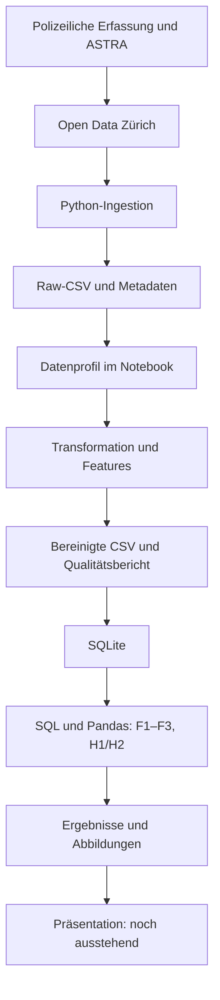

# Verkehrsunfälle in der Stadt Zürich – Data Engineering, Teil 1

ZHAW-Projektarbeit im Modul Data Engineering, HS26.
Team: Ruben Souto, Issa Fawaz und Drin Muslija.

Wir analysieren **70'767 polizeilich registrierte Verkehrsunfälle von 2011–2025**.
Eine lokale Python-Pipeline verarbeitet einen festgehaltenen Open-Data-Snapshot
und speichert den aufbereiteten Bestand in SQLite. Zwei ausgeführte Notebooks
dokumentieren Datenqualität, Hypothesentests und Antworten auf die Forschungsfragen.

**Stand:** Konzeption und technische Teil-1-Inhalte sind erarbeitet und geprüft.
Teamreview, Präsentation und eingefrorener GitHub-Abgabe-Branch stehen noch aus.
Es werden keine Machine-Learning-Modelle gebaut.

## Inhalt

- [Konzeptionalisierung](#konzeptionalisierung)
- [Datenquelle und Grenzen](#datenquelle-und-grenzen)
- [Data-Engineering-Lebenszyklus](#data-engineering-lebenszyklus)
- [Technische Entscheidungen](#technische-entscheidungen)
- [Ergebnisse und Interpretation](#ergebnisse-und-interpretation)
- [Installation und Ausführung](#installation-und-ausführung)
- [Datenbank verstehen und benutzen](#datenbank-verstehen-und-benutzen)
- [Dateien und Artefakte](#dateien-und-artefakte)
- [Prüfung und Abgabe](#prüfung-und-abgabe)

## Konzeptionalisierung

### Problemstellung und Ausgangslage

Verkehrsunfälle verursachen Personen- und Sachschäden. Wir untersuchen, wann
registrierte Unfälle auftreten, wie Beteiligung und Schwere zusammenhängen und
wie sich der Bestand über die Jahre verändert. Die Ergebnisse beschreiben Muster
und können weiterführende Untersuchungen zur Verkehrssicherheit unterstützen.
Sie begründen allein keine konkreten Verkehrsmassnahmen.

Die Data-Engineering-Aufgabe ist, veröffentlichte Daten reproduzierbar zu beschaffen,
ihre Qualität zu beurteilen, begründet aufzubereiten und für SQL-/Python-Analysen
bereitzustellen. Untersuchungsgebiet ist die Stadt Zürich, eine Zeile entspricht
einem Unfall. Individuelle Personen oder Fahrzeuge sind keine eigenen Beobachtungen.

### Forschungsfragen und Hypothesen

| Frage | Methode |
|---|---|
| **F1:** Wie unterscheiden sich registrierte Verkehrsunfälle nach Tageszeit und Wochentag? | Häufigkeiten, Heatmap, relative Stundenverteilungen und H1 |
| **F2:** Besteht bei registrierten **Personenschadenunfällen** ein Zusammenhang zwischen Fussgänger-, Velo- bzw. Motorradbeteiligung und Unfallschwere? | Drei Kreuztabellen, bedingte Schwereanteile und H2 |
| **F3:** Wie haben sich Anzahl und Zusammensetzung der registrierten Verkehrsunfälle über die Jahre verändert? | Jahreszahlen sowie Schwere- und Beteiligungsanteile; deskriptiv |

**H1 – zeitliche Verteilung:** H0: Die Verteilung der Unfallstunden ist an
Werktagen und Wochenenden gleich. Die Alternativhypothese besagt, dass sie sich
unterscheidet. Testtabelle: Montag–Freitag gegenüber Samstag/Sonntag × 24 Stunden.
Feiertage sind nicht separat erfasst. Relative Verteilungen innerhalb jeder Gruppe
vermeiden einen blossen Gesamtvergleich von fünf Werktagen mit zwei Wochenendtagen.

**H2 – Beteiligung und Schwere:** Je Beteiligungsmerkmal lautet H0, dass dessen
Vorliegen und die Unfallschwere innerhalb der Personenschadenunfälle unabhängig
sind. Die Alternativhypothese besagt, dass ein Zusammenhang besteht. Getestet wird
beteiligt/nicht beteiligt × Leichtverletzte/Schwerverletzte/Getötete. Jeder Unfall
zählt je Test einmal, darf aber mehrere Beteiligungsmerkmale besitzen.
Die Beschränkung auf Personenschäden folgt aus der unten beschriebenen
Definitionsdiskrepanz; sie gilt ausdrücklich auch für F2.

### Vorgehen und Methoden

Quelle und Snapshot identifizieren → Datenprofil erstellen → Bereinigungsregeln
ableiten → bereinigten Bestand in SQLite speichern → F1–F3 analysieren.

H1 und H2 verwenden den Pearson-Chi-Quadrat-Test ohne Kontinuitätskorrektur.
Das Signifikanzniveau beträgt 0,05. Die drei H2-p-Werte werden mit Holm gemeinsam
korrigiert; H1 ist eine separate Testfamilie. Berichtet werden zusätzlich
Fallzahlen, erwartete Zellhäufigkeiten und Cramérs V als Effektgrösse.
Alle erwarteten Zellen im aktuellen Bestand liegen über 5. Eine reproduzierbare
Monte-Carlo-Alternative für dünn besetzte Tabellen ist implementiert und getestet,
wurde für die Projektergebnisse aber nicht benötigt.

Deskriptive Tabellen nach Jahr ordnen die gepoolten Ergebnisse ein. Sie ersetzen
keine Kontrolle sämtlicher Einflussfaktoren oder zeitlicher Abhängigkeiten.
Ein nicht signifikanter Test würde keine Unabhängigkeit beweisen. F3 erfordert
keine zusätzliche gerichtete Hypothese und wird ohne vorweggenommenen Trend beantwortet.

Methodenquellen: [SciPy chi2_contingency](https://docs.scipy.org/doc/scipy/reference/generated/scipy.stats.chi2_contingency.html);
Holm (1979), *A Simple Sequentially Rejective Multiple Test Procedure*,
Scandinavian Journal of Statistics 6(2), 65–70. Implementierung: `analysis.py`.

## Datenquelle und Grenzen

Quelle: [Polizeilich registrierte Verkehrsunfälle auf dem Stadtgebiet Zürich seit 2011](https://data.stadt-zuerich.ch/dataset/sid_dav_strassenverkehrsunfallorte).
CSV: [RoadTrafficAccidentLocations.csv](https://data.stadt-zuerich.ch/dataset/sid_dav_strassenverkehrsunfallorte/download/RoadTrafficAccidentLocations.csv).

- Datenowner: Dienstabteilung Verkehr; Datenlieferant und geforderte Quellenangabe:
  **Bundesamt für Strassen ASTRA**.
- Lizenz laut Katalog: Creative Commons Attribution.
- Katalogstand der Quellenprüfung am 13. Oktober 2026: Zeitraum 2011–2025,
  Aktualisierung 11. März 2026, jährliches Aktualisierungsintervall.
- Snapshot: 36 Spalten, 38'710'929 Bytes, 70'767 eindeutige Unfall-IDs.
  Abrufzeitpunkt, URLs und SHA-256-Prüfsumme stehen in `source_metadata.json`.
- Merkmale: Jahr, Monat, Wochentag, Stunde, Unfalltyp, Schweregrad, Strassenart,
  Beteiligungsmerkmale und LV95-Koordinaten. Ein exaktes Unfalldatum fehlt.

**Zwei wesentliche Quellenprobleme:** Seit 1. Juli 2015 werden auch polizeilich
registrierte Bagatellunfälle als Sachschäden gemeldet. Ein Anstieg der Gesamtzahl
über diesen Bruch darf nicht automatisch als Verschlechterung interpretiert werden.
Ausserdem beschreibt der Katalog Beteiligungsmerkmale mit Bezug auf Personenschäden,
während der Snapshot auch positive Angaben bei Sachschäden enthält: Fussgänger 169,
Velo 1'612, Motorrad 1'777. Die Ursache ist nicht geklärt. Werte werden erhalten,
H2 wird vorsichtig auf Personenschäden beschränkt. Velobeteiligung umfasst laut
Katalog auch E-Bikes.

Nicht registrierte Unfälle fehlen. Ohne Verkehrsaufkommen bzw. Verkehrsleistung
lassen sich keine Risiken pro Person, Fahrt oder Kilometer berechnen. Zusammenhänge
belegen keine Kausalität; Wetter, Infrastruktur und Exposition sind nicht kontrolliert.
Schwere bezeichnet den gesamten Unfall und identifiziert nicht die verletzte Person.

## Data-Engineering-Lebenszyklus

Wir verwenden eine lokale Batch-Pipeline. Die jährliche Quelle und der aktuelle
Umfang benötigen keine Echtzeitverarbeitung und keinen Datenbankserver.



| Phase | Umsetzung und Begründung |
|---|---|
| Generation | Polizeiliche Erfassung und Meldung im ASTRA-System ausserhalb des Projekts; Definitionen und Erfassungsbrüche bestimmen die Aussagekraft |
| Ingestion | Öffentliche CSV und Katalogmetadaten beziehen; lokaler Snapshot mit Prüfsumme, Format- und Pflichtspaltenprüfung |
| Storage | Unveränderte Raw-Dateien als Ausgangspunkt; aufbereiteter Bestand in CSV und SQLite. Speicherung begleitet mehrere Phasen |
| Transformation | Profilbefunde begründen Typisierung, Spaltenauswahl und drei Features; Qualitätsbericht dokumentiert die Verarbeitung |
| Serving | Teil 1: lesende SQL-/Notebook-Analyse und Ergebnisartefakte; Präsentation folgt. Ein eigener Serving-Dienst bleibt Teil 2 |

### Unterströmungen

| Bereich | Projektentscheidung |
|---|---|
| Sicherheit | Öffentliche Daten, keine Zugangsdaten im Repository; keine Verknüpfung zur Identifizierung beteiligter Personen |
| Datenmanagement/Governance | Quelle, Lizenz, Definitionen und Datenstand dokumentieren; Rohdaten erhalten, Herkunft über Prüfsummen nachvollziehen |
| DataOps/Datenqualität | Sichtbarer Abbruch bei Fehlern, Qualitätsbericht, Tests, Datenbankintegrität und dokumentierte Referenzumgebung |
| Orchestrierung | `pipeline.py`: Snapshot-Pfad → Transformation → SQLite; Fehler stoppen nachfolgende Schritte |
| Software Engineering | Getrennte Module, zentrale Pfade, gemeinsame Funktionen, Kommentare, Tests und Git-Review; Zuständigkeiten für Notebooks/Folien vergeben |
| Architektur/Skalierbarkeit | Dateien und Pfadübergaben trennen Komponenten. Bei wesentlich mehr Daten chunkweise Verarbeitung prüfen; bei gemeinsamer Servernutzung PostgreSQL evaluieren |

## Technische Entscheidungen

### Speicherung evaluieren und begründen

| Option | Eignung | Entscheidung |
|---|---|---|
| CSV | Originalformat und Austausch einfach; keine Constraints, Datentypen müssen beim Einlesen gesetzt werden | Raw-Snapshot und bereinigter Export |
| SQLite | SQL, Schlüssel, Constraints und Transaktionen in einer portablen Datei; Schreibzugriffe serialisiert | Für den lokalen, überwiegend lesenden Bestand gewählt |
| PostgreSQL | Zentrale Datenbank für mehrere Nutzer; Server, Zugangsdaten und Betrieb erforderlich | Aktuell zusätzlicher Aufwand ohne passenden Bedarf |

Der strukturierte Datensatz eignet sich für relationale Speicherung: stabile
Spalten, eine eindeutige Unfall-ID und Aggregationen nach Jahr, Zeit und Schwere.
Eine Unfalltabelle genügt; zusätzliche Dimensionstabellen sind für diese Fragen
nicht erforderlich. Rohdaten bleiben vollständig für spätere Erweiterungen erhalten.

### Datenprofil und initiale Bereinigung

Das ausgeführte Profil zeigt keine leeren Felder, geprüften NA-Marker,
Rand-Leerzeichen oder Duplikate. Zeitfelder liegen in den zulässigen Bereichen.
Alle 180 Jahr-Monat-Kombinationen sind vertreten; dies beweist keine vollständige
Erfassung aller Tage. Gemeindecode ist durchgehend `0261`, Kanton `ZH`.
803 Unfälle besitzen mehrere positive Beteiligungsmerkmale.

**Keine Zeilenlöschung und keine Imputation:** Die Transformation wählt 19
Originalfelder aus, setzt Datentypen und ergänzt drei Features. Sprachvarianten
und redundante Beschreibungen bleiben im Raw-Snapshot. ID, Originalcodes, relevante
deutsche Bezeichnungen, Beteiligung und Koordinaten bleiben rückverfolgbar.

Nicht leere ungültige Werte und doppelte IDs führen zum Abbruch. Leere Angaben
bleiben unbekannt. Numerische Koordinatenprüfung ist keine Stadtgrenzenprüfung.
CSV speichert boolesche Werte als 0/1 und unbekannte Werte leer; `read_clean()`
stellt Datentypen wieder her und erhält führende Nullen in Textcodes.
Quell-/Ergebnisprüfsummen, Regelversion und betroffene Werte stehen im Qualitätsbericht.

### Features verstehen

Ein Feature ist eine zusätzlich berechnete Spalte, kein Machine-Learning-Modell.

| Feature | Regel | Nutzen |
|---|---|---|
| `is_weekend` | Samstag/Sonntag → 1, Montag–Freitag → 0, fehlend → unbekannt | F1/H1 gruppieren; Feiertage werden nicht erkannt |
| `time_period` | 00–05 `night`, 06–11 `morning`, 12–17 `afternoon`, 18–23 `evening`; fehlend → unbekannt | Verständliche Tageszeitgruppen; H1 verwendet die erhaltenen 24 Unfallstunden |
| `vulnerable_road_user` | Fussgänger ODER Velo: mindestens eines positiv → 1, beide negativ → 0, sonst unbekannt | Ergänzende Gruppierung für weitere Analysen; ersetzt nicht die drei getrennten H2-Tests und ist im aktuellen Ergebnistest kein eigener Faktor |

## Ergebnisse und Interpretation

| Frage | Antwort im untersuchten Bestand | Einordnung |
|---|---|---|
| F1 | Häufigste Stunde werktags 17 Uhr, am Wochenende 14 Uhr; Nachtanteil 3,71 % gegenüber 14,63 %. H1: χ²(23) = 3'877,06, p < 0,001, V = 0,234 | Stundenanteile innerhalb jeder Gruppe; keine Risiken pro Fahrt |
| F2 | Alle drei H2-Vergleiche nach Holm signifikant; V: Fussgänger 0,104, Velo 0,054, Motorrad 0,036. Schwer/tödlich mit Fussgängerbeteiligung 23,42 %, ohne 15,02 % | Nur 18'164 Personenschadenunfälle, kleine Effekte, kein Kausalitätsnachweis |
| F3 | Gesamtzahl 3'420 (2011) → 4'714 (2025); Personenschäden 1'072 → 1'310. Veloanteil an Personenschadenunfällen 26,12 % → 40,38 % | Gesamtzahlen über den Erfassungswechsel 2015 eingeschränkt vergleichbar |

Die kleinste erwartete Zelle beträgt bei H1 114,61, bei H2 mindestens 15,59.
H1 zeigt einen numerischen p-Wert-Unterlauf; das bedeutet nicht exakt null.
Ein kleiner p-Wert allein beschreibt keine praktische Relevanz. Effektgrössen,
Fallzahlen und konkrete Anteile gehören deshalb zur Interpretation. Jahreskontrollen
sind deskriptiv; zeitliche Unabhängigkeit wird dadurch nicht bewiesen.
Beteiligungsanteile können wegen Mehrfachbeteiligung zusammen über 100 % liegen.

Details: [Analyse-Notebook](notebooks/02_analyse.ipynb) und
[Ergebnisgrundlage für spätere Folien](presentations/teil1_ergebnisse.md).

Das [fachliche Review](docs/fachliches_review_teil1.md) bestätigt die unabhängige
Nachrechnung, präzisiert aber die Interpretation: Der höhere Nachtanteil am
Wochenende zeigt sich in 15/15 Jahren. Höhere schwere/tödliche Anteile mit
Fussgängerbeteiligung zeigen sich ebenfalls in 15/15 Jahren, mit Velo in 11/15 und
mit Motorrad in 13/15 Jahren. Das sind deskriptive Kontrollen, keine adjustierten Tests.
F3 zeigt keine stetige Zunahme: Das Maximum liegt 2018 bei 5'677 Unfällen;
2016–2025 sinkt die Gesamtzahl von 5'556 auf 4'714, während Personenschäden
von 1'262 auf 1'310 steigen. Diese Zahlen beschreiben Unfälle, keine verletzten Personen.

## Installation und Ausführung

### Voraussetzungen und Referenzumgebung

Projektanforderung: Python >= 3.11 und SQLite >= 3.37 (für `STRICT`-Tabellen).
Die geprüfte Referenzumgebung ist **Windows, Python 3.14.3, SQLite 3.50.4**.
`requirements-lock.txt` hält die installierten Paketversionen dieser Umgebung
fest; es ist kein plattformübergreifend aufgelöster Lockfile. Andere Python-/OS-
Kombinationen sind noch nicht gesondert geprüft. Python bringt `sqlite3` mit.

Alle folgenden Befehle werden im Repository-Hauptverzeichnis ausgeführt.
Windows/PowerShell – ohne nötige Aktivierung der virtuellen Umgebung:

```powershell
python -m venv .venv
.\.venv\Scripts\python.exe -m pip install -r requirements-lock.txt
.\.venv\Scripts\python.exe -m pip install --no-deps -e .
.\.venv\Scripts\python.exe -c "import sqlite3; print(sqlite3.sqlite_version)"
```

Die folgenden `python`-Befehle meinen diesen Interpreter. Nach Aktivierung mit
`.\.venv\Scripts\Activate.ps1` kann direkt `python` verwendet werden; alternativ
jedes `python` durch `.\.venv\Scripts\python.exe` ersetzen.
Für eine andere kompatible Umgebung die Projektanforderungen mit
`python -m pip install -e ".[dev]"` installieren und den Ablauf gesondert prüfen.

### Standardablauf für Teil 1

```bash
# 1. Vorhandenen Snapshot offline prüfen; CSV, Qualitätsbericht und SQLite erneuern.
python -m de_projekt.pipeline

# 2. Datenprofil vollständig ausführen.
python -m jupyter nbconvert --to notebook --execute --inplace notebooks/01_datenprofil.ipynb

# 3. Analyse und Ergebnisartefakte vollständig erzeugen.
python -m jupyter nbconvert --to notebook --execute --inplace notebooks/02_analyse.ipynb

# 4. Automatisierte Prüfungen.
python -m pytest
python -m ruff check .
```

Die bereits abgeleiteten Bereinigungsregeln machen den Pipeline-Lauf möglich.
Bei einer **neuen Quelle oder neuen Regeln** kommt das Datenprofil fachlich zuerst.
Der Standardablauf benötigt für den vorhandenen Snapshot keinen erneuten Download.
Notebooks können auch in JupyterLab mit dem Projekt-Kernel von oben nach unten
ausgeführt werden. Sie schreiben Berichte und Abbildungen; die Analyse öffnet SQLite
nur lesend. Erstellzeitpunkte ändern sich beim Neulauf, die fachlichen Ergebnisse
bleiben bei gleichem Snapshot, Regeln und Referenzumgebung reproduzierbar.

Einzelschritte: `python -m de_projekt.ingestion`, `python -m de_projekt.transformation`,
`python -m de_projekt.storage`. Neue Raw-Daten nur bewusst mit
`python -m de_projekt.ingestion --refresh` beziehen; sie werden separat unter
`data/raw/snapshots/<UTC-Zeitstempel>/` gespeichert und müssen explizit gewählt werden.
Unvollständige lokale Snapshots werden nicht still durch Downloads ersetzt.

**Alternative Stände:** Die Pipeline unterstützt `--raw-dir` und `--output-dir`.
Die Notebooks verwenden derzeit die Standardpfade aus `config.py`; ein anderer
Pipeline-Ausgabeordner wird von ihnen nicht automatisch ausgewertet. Für die
Abgabe verwenden wir den dokumentierten Standard-Snapshot und dieselben Pfade.

## Datenbank verstehen und benutzen

### Reicht die Datei?

**Ja, zum Öffnen und SQL-Abfragen reicht `data/processed/accidents.sqlite`.**
Die Datei enthält Tabellen, Daten und Regeln; sie ist kein Link auf einen Server.
Es braucht kein Konto und keine Zugangsdaten. Ein SQLite-fähiges GUI ist optional.
Für reproduzierbare Projektabgabe werden zusätzlich Code, Rohdaten, Metadaten und
Notebooks benötigt. Unser Analyse-Notebook prüft auch diese Herkunftsartefakte.

| Tabelle | Zweck |
|---|---|
| `accidents` | 70'767 Unfälle, 22 Spalten; `AccidentUID` ist der eindeutige Primärschlüssel |
| `pipeline_metadata` | Quelle, Prüfsummen, Regel-/Schemaversion, Zeilenzahl und SQLite-Version; keine fachliche Dimension |

Schema: [schema.sql](src/de_projekt/schema.sql). `TEXT` für IDs und Kategorien,
`INTEGER` für Zeitfelder und 0/1-Merkmale, `REAL` für Koordinaten.
`NULL` bedeutet unbekannt, 0 bei Beteiligung ausdrücklich negativ.
`CHECK` schützt Wertebereiche und Beziehungen zwischen Features und Eingangsmerkmalen;
`STRICT` beschränkt die gespeicherten Datentypen. Der Primärschlüssel verhindert Duplikate.

### Datenbank lesend mit Python öffnen

Beispiel für eine Notebook-Zelle oder Python-Sitzung im Projekt:

```python
import sqlite3
from contextlib import closing
from de_projekt import config

db = config.PROCESSED_DIR / config.DATABASE_FILENAME
with closing(sqlite3.connect(db.resolve().as_uri() + "?mode=ro", uri=True)) as connection:
    print(connection.execute("SELECT COUNT(*) FROM accidents").fetchone())
    print(connection.execute("PRAGMA integrity_check").fetchone())
```

Erwartet: `(70767,)` und `('ok',)`. Die lesende Verbindung verhindert Änderungen.

SQL-Beispiele für die Forschungsfragen:

```sql
-- F1: Fallzahlen nach Wochentag und Stunde.
SELECT AccidentWeekDay, AccidentHour, COUNT(*) AS accident_count
FROM accidents
GROUP BY AccidentWeekDay, AccidentHour;

-- F2: Velo-Kreuztabelle, nur Personenschadenunfälle.
SELECT AccidentInvolvingBicycle, AccidentSeverityCategory, COUNT(*) AS accident_count
FROM accidents
WHERE AccidentSeverityCategory IN ('as1', 'as2', 'as3')
GROUP BY AccidentInvolvingBicycle, AccidentSeverityCategory;

-- F3: Jahreszahlen nach Schweregrad.
SELECT AccidentYear, AccidentSeverityCategory, COUNT(*) AS accident_count
FROM accidents
GROUP BY AccidentYear, AccidentSeverityCategory
ORDER BY AccidentYear, AccidentSeverityCategory;
```

### Erzeugung und Schutz

`storage.py` prüft CSV und Qualitätsbericht, baut eine neue Datenbank temporär und
transaktional auf und vergleicht alle gespeicherten Werte mit der CSV. Erst nach
Integritätsprüfung und Schliessen wird die bisherige Datei atomar ersetzt.
Wiederholte Läufe hängen keine Unfälle an. Bei Aufbaufehlern bleibt die alte DB erhalten.
Programme mit offener DB-Datei unter Windows vor dem Austausch schliessen.
Zusätzliche Analyseindizes werden erst bei nachgewiesenem Bedarf evaluiert.

CSV und Qualitätsbericht werden einzeln atomar ersetzt, bilden aber keine gemeinsame
Dateitransaktion. Ein Abbruch zwischen den Ersetzungen ist über die Prüfsumme erkennbar;
Storage lehnt ein unpassendes Paar ab. Raw-Dateien werden nie überschrieben.

## Dateien und Artefakte

Ein Artefakt ist eine gespeicherte Datei, die Daten, Umsetzung oder Ergebnisse belegt.

| Ort | Inhalt / Erzeugung | Für Teil 1 behalten |
|---|---|---|
| `README.md`, `pyproject.toml`, `requirements-lock.txt` | Konzept, Anleitung und Umgebung | Ja |
| `src/de_projekt/`, `tests/` | Kommentierter Code, SQL-Schema und Prüfungen | Ja |
| `data/raw/RoadTrafficAccidentLocations.csv` | Unveränderter öffentlicher Snapshot | Ja |
| `data/raw/catalog_metadata.json`, `source_metadata.json` | Quelle und Snapshot-Prüfsumme | Ja |
| `data/processed/accidents_clean.csv`, `quality_report.json` | Transformationsergebnis und Herkunft/Qualität | Ja |
| `data/processed/accidents.sqlite` | SQLite-Speicherartefakt | Ja |
| `notebooks/01_datenprofil.ipynb`, `02_analyse.ipynb` | Ausgeführte Profilierung und Analyse | Ja |
| `data/processed/data_profile.json`, `profile_annual_counts.png` | Profilbericht und -abbildung | Ja |
| `data/processed/analysis_summary.json`, `annual_counts.csv`, `hypothesis_tests_h2.csv` | Analyseergebnisse und Prüfsummen | Ja |
| `presentations/figures/`, `teil1_ergebnisse.md` | Vier Abbildungen und Grundlage für Folien | Ja |
| Präsentation | Zusammenfassung aller geforderten Teile | Noch zu erstellen |
| `.venv/`, Caches und SQLite-Nebendateien | Lokale Umgebung / temporäre Arbeitsdateien | Nein; ignoriert |

Module: `config.py` setzt Pfade, `ingestion.py` sichert den Snapshot,
`transformation.py` bereitet auf, `storage.py` speichert, `pipeline.py` koordiniert,
`analysis.py` enthält statistische Funktionen. `serving.py` bleibt ein Platzhalter
für Teil 2 und wird in der Teil-1-Pipeline nicht aufgerufen.

## Prüfung und Abgabe

### Zuordnung zur Aufgabenfolie

| Geforderter Teil | Nachweis | Aktueller Stand |
|---|---|---|
| Konzeptionalisierung (grün) | Problem, Fragen, Hypothesen, Methoden im README | Erarbeitet; in Präsentation übernehmen |
| Lebenszyklusentwurf (grün) | Diagramm, fünf Phasen und Unterströmungen | Erarbeitet; in Präsentation übernehmen |
| Ingestion (blau) | Identifizierte Quelle, Raw-Daten, Metadaten und Code | Implementiert und geprüft |
| Storage (blau) | Optionenvergleich, Auswahl, SQL-Schema und SQLite-Datei | Implementiert und geprüft |
| Transformation Teil 1 (blau) | Profil, Bereinigung, H1/H2 und Code/Notebooks | Ausgeführt und geprüft |
| Forschungsfragen beantworten (grün) | Ergebnistabelle, Notebook und Interpretation | Dokumentiert; in Präsentation übernehmen |

**Grün:** Präsentation. **Blau:** Präsentation plus technische Artefakte.
Das README ist Arbeitsdokumentation und ersetzt die geforderte Präsentation nicht.

Kohärenz und Vollständigkeit werden über diese Zuordnung geprüft; Fachlichkeit und
Objektivität über Methoden, Annahmen und Grenzen; Funktionalität über Tests und
ausgeführte Artefakte. Skalierbarkeit folgt aus getrennten Komponenten. Eigene
begründete Entscheidungen (zeitliche Normierung, Mehrfachbeteiligung, Quellenbruch)
tragen zu Originalität und Eigenständigkeit bei. Relevanz und Effektgrössen
betreffen Signifikanz im Bewertungssinn, nicht nur statistische p-Werte.
Das Team muss Entscheidungen selbst prüfen und erklären können sowie Hilfsmittel
und externe Quellen gemäss Kursvorgaben angeben. Eine Bewertung von 3–4 Punkten
wird angestrebt, ist aber nicht zugesichert.

### Geprüfter Stand und verbleibende Aufgaben

- [x] Quelle, Snapshot und Lebenszyklus dokumentiert.
- [x] Datenprofil, Bereinigung, SQLite und Pipeline ausgeführt.
- [x] F1–F3 beantwortet; H1/H2 mit Effektgrössen und Grenzen dokumentiert.
- [x] 43 Tests erfolgreich; Ruff ohne Beanstandungen; beide Notebooks ausgeführt.
- [x] Referenzversionen festgehalten und Standardablauf in frischer Umgebung geprüft.
- [ ] Teamreview: Forschungsfragen, Methoden, SQL und Ergebnisgrenzen gemeinsam erklären.
- [ ] Alle vorgesehenen Abgabedateien in Git aufnehmen und den Diff prüfen.
- [ ] Präsentation erstellen – nach Dokumentations- und Technikreview.
- [ ] Abschliessenden Stand prüfen und separaten GitHub-Abgabe-Branch einfrieren.

Aktuell liegen Änderungen und neue Dateien im Arbeitsbaum; ein lokales Artefakt
ist erst nach Aufnahme und Commit Bestandteil des Git-Abgabestands. Ein Review
erfolgt mit `git status --short` und `git diff`. Aktueller Arbeitsbranch ist
`feature/accident-data`; er ist noch kein eingefrorener Abgabe-Branch.
Binäre Datenbanken und Notebooks nicht gleichzeitig durch mehrere Personen
bearbeiten. Zuständigkeiten vergeben und abgeleitete Dateien kontrolliert erzeugen.

Abgabe laut Projektvorgaben: Teil 1 **27. Oktober 2026, 23:59 Uhr**;
Teil 2 **8. Dezember 2026, 23:59 Uhr**. Code, Daten, Datenbank und Präsentation
gehören auf den separaten Abgabe-Branch. Nach dem Einfrieren keine neuen Quellenstände
oder Pipeline-Läufe in diesen Stand übernehmen. Finaler Lebenszyklus,
Transformation Teil 2 und Serving werden separat in Teil 2 bewertet.
